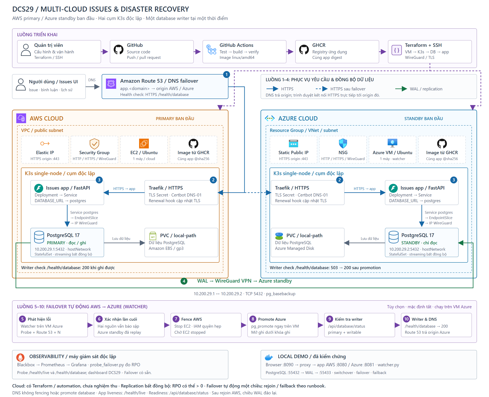

# DCS29 — kiến trúc Issues và disaster recovery AWS / Azure

Sơ đồ cập nhật ngày 23/10/2026 theo mã nguồn và cấu hình trong repo (nhánh `revamp`).



- [PNG để chèn báo cáo — 2400 × 1950](kien-truc-multi-cloud.png)
- [SVG độc lập, có thể chỉnh sửa](kien-truc-multi-cloud.svg)

## Trạng thái triển khai

**Local đã được kiểm chứng**, gồm Issues, hai PostgreSQL 17 streaming bất đồng bộ, proxy chung, `switchover`, `failover`, rejoin, failback và watcher tự failover. **Cloud đã có cấu hình Terraform và automation, cần nghiệm thu trên hai VM thật.** Failover cloud tự động mặc định tắt (`enable_auto_failover = false`); rejoin và failback cloud theo runbook. Sơ đồ thể hiện cấu trúc trong repo, không phải bằng chứng nghiệm thu cloud.

## Kiến trúc cloud trong mã nguồn

1. GitHub Actions kiểm thử với PostgreSQL, build `linux/amd64`, phát hành GHCR và kéo/chạy image để kiểm tra. Hai cloud dùng cùng digest ứng dụng; cấu hình `APP_ENV`, `APP_REGION`, `DATABASE_URL` riêng.
2. Terraform tạo AWS EC2 trong VPC/public subnet với SG, Elastic IP và EBS; Azure Ubuntu VM trong Resource Group/VNet/subnet với NSG, Static Public IP và Managed Disk. Automation SSH dựng **hai cụm K3s single-node độc lập**. Traefik Ingress nhận HTTPS, chuyển tới Service/Deployment FastAPI Issues. Certbot DNS-01 Route 53 cấp chứng chỉ; hook renewal cập nhật TLS Secret.
3. Mỗi cloud có PostgreSQL 17 StatefulSet, `hostNetwork`, PVC `local-path`. Service `postgres` dùng EndpointSlice trỏ IP WireGuard tại cùng cloud. AWS `10.200.29.1:5432` là primary; Azure `10.200.29.2:5432` là standby ban đầu. Standby clone bằng `pg_basebackup`, nhận WAL qua WireGuard. Đây là physical streaming replication bất đồng bộ; có thể mất giao dịch cuối nếu primary sập.
4. Route 53 trả A record AWS PRIMARY hoặc Azure SECONDARY, TTL 60 giây. Client tra DNS rồi kết nối HTTPS trực tiếp tới origin. Health check dùng **`/health/database`**, yêu cầu database kết nối được và cho phép ghi. Azure standby trả 503 cho endpoint này dù ứng dụng có thể phục vụ đọc. DNS không thực hiện fencing hay promotion.
5. Nhánh tự động tùy chọn là **watcher** chạy như dịch vụ `systemd` trên VM Azure, ngoài region cần giám sát. Mỗi vài giây nó hỏi hai nguồn: probe `/health/database` của AWS từ chính VM Azure, và trạng thái health check Route 53 (nhiều vùng). Chỉ khi cả hai cùng báo AWS sập N lần liên tiếp nó mới hành động: kiểm tra lần cuối, `preflight` (Azure là standby đã replay hết WAL), dừng EC2 bằng IAM user quyền hẹp và chờ `stopped` (fence), `pg_promote` rồi mở ghi, và chờ Azure báo `primary` + `writable`. Sau đó Route 53 thấy Azure là origin khỏe duy nhất và chuyển DNS. Không fence được thì dừng và thoát mã 2 để người vận hành xử lý. Không tự failback; rejoin AWS thành standby rồi chuyển writer theo runbook.

Liveness của app dùng `/health/live`; readiness Kubernetes dùng `/api/database/status`. Hai probe này có mục đích khác writer health check `/health/database`. Sau failover, chiều replication chuyển Azure → AWS khi AWS được rejoin. Chỉ khởi động lại EC2 không đủ để phục hồi an toàn.

## Mô hình local và observability

Local: browser `127.0.0.1:8090` → proxy → backend AWS `8080` / Azure `8081`; hai PostgreSQL Docker ở `55432` / `55433`. `scripts/local_replication.py` điều phối khóa ghi, drain giao dịch, cô lập primary cũ, promote, đổi writer proxy, rejoin và failback: `switchover` khi AWS còn sống (không mất dữ liệu), `failover` khi AWS đã sập. `scripts/watcher.py` tự gọi `failover` khi probe web và kết nối database AWS cùng báo lỗi. Bản nháp ở localStorage trình duyệt chưa phải dữ liệu PostgreSQL đã commit. Local dùng mạng Docker, không dùng Route 53 hay WireGuard.

Repo có stack Prometheus, Blackbox Exporter và Grafana chạy trên máy độc lập. Prometheus có hai job: `blackbox_https` (probe `/health/live` của hai origin và tên miền chung) và `blackbox_writer` (probe `/health/database`, chỉ writer báo thành công). Grafana có sẵn dashboard `DCS29 - Failover`. `scripts/probe_failover.py` chạy từ laptop, ghi CSV và tính downtime, tỷ lệ lỗi, latency và số lần ghi bị mất; cách đo và định nghĩa số liệu ở [đo đạc failover](../docs/DO_DAC_FAILOVER.md).

## Nguồn đối chiếu

- [README và trạng thái kiểm chứng](../README.md)
- [Manifest app và database](../deploy/terraform/automation/templates/)
- [DNS và writer health checks](../deploy/terraform/dns.tf)
- [WireGuard và workload automation](../deploy/terraform/automation/deploy.py)
- [HTTPS automation](../deploy/terraform/https/remote.py)
- [Watcher failover: Terraform](../deploy/terraform/watcher.tf), [dịch vụ trên VM Azure](../deploy/terraform/watcher/cloud_watcher.py), [lõi quyết định dùng chung](../scripts/watcher_core.py)
- [Local replication](../docs/LOCAL_REPLICATION.md)
- [Triển khai Terraform](../docs/giai-doan/tu_dong/TRIEN_KHAI_BANG_TERRAFORM.md)
- [Failover tự động bằng watcher](../docs/giai-doan/tu_dong/AUTOMATION_FAILOVER.md)
- [Cấu hình observability](../observability/prometheus.yml)
- [Trade-off và độ phức tạp vận hành](../docs/TRADE_OFFS.md)

## Chỉnh sửa hình

`kien-truc-multi-cloud.svg` là nguồn duy nhất của sơ đồ; không còn script sinh hình. Sửa trực tiếp các phần tử `<text>`, `<rect>`, `<path>` trong SVG (mở được bằng trình soạn thảo hoặc Inkscape). Các icon đã được nhúng dạng base64 trong chính file SVG, nên SVG không cần tài nguyên ngoài; thư mục `icons/` chỉ giữ bản gốc của các icon đó (AWS/Azure architecture icons và logo phần mềm Simple Icons).

Xuất PNG bằng Chrome headless (điều chỉnh đường dẫn Chrome nếu cần):

```powershell
& 'C:/Program Files/Google/Chrome/Application/chrome.exe' --headless --disable-gpu --hide-scrollbars --force-device-scale-factor=1 --window-size=2400,1950 --user-data-dir="$env:TEMP/architecture-chrome" --screenshot="$PWD/images/kien-truc-multi-cloud.png" "file:///$($PWD.Path.Replace('\','/'))/images/kien-truc-multi-cloud.svg"
```

Khi kiến trúc đổi, sửa SVG, xuất lại PNG và cập nhật ngày ở đầu tài liệu này.
